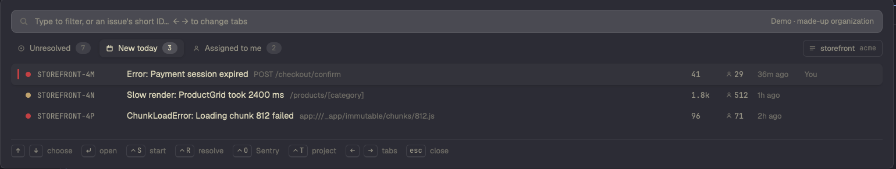

# Sentry for Herdr

A [Herdr](https://herdr.dev) mod: your Sentry issues in a popup. Open an issue to see its latest exception, stack and tags. Resolve, archive or take it. One key starts an agent on it.

`RECIPE.md` tells how the mod looks and behaves, and how to build it from scratch.

## Install

1. Copy `mods/sentry/` into `~/.config/herdr-app/mods/`.
2. Merge `keys.json` into `~/.config/herdr-app/keys.json`. It binds ⌘S to open the popup.
3. Run `sentry-cli login`, or set `SENTRY_AUTH_TOKEN`. Give the token the scopes `org:read`, `project:read`, `event:read` and `event:write`. Add `member:read` to use "take it".
4. Run `herdr-app check ~/.config/herdr-app/mods/sentry`.

To try it without a token, open the popup and run `herdr-app do sentry.demo`.

The mod runs `sh` and `curl` to reach Sentry's API, and reads `~/.sentryclirc`.

## Credits

`mods/sentry/look.js` and the icons in `mods/sentry/icons/` come from the `linear` mod that ships with Herdr. They give this popup the same look as Herdr's Linear popup. They belong to Herdr's authors and are not covered by this repo's MIT license. The rest of the code is under the MIT license in `LICENSE`.
