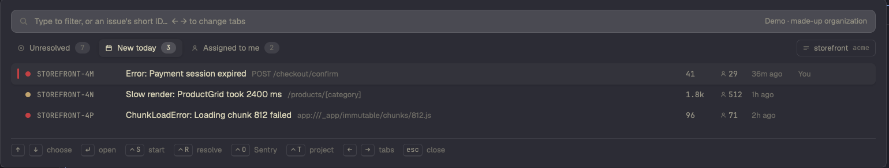

# Sentry

A popup with your Sentry issues, in the same style as Herdr's Linear popup. ⌘S opens it. It shows the unresolved issues, the issues that are new today and the issues assigned to you. Open an issue to see its counts, the latest exception, the stack and the tags. From the popup you can resolve, archive or take an issue. One key starts a coding agent on the issue, in a new tab of the space where the project's repo is.

## What you see

The popup is a Herdr overlay: `kind: "popup"`, at the top, 40px down, 80% of the window wide and high. The background is `theme().popover`, with 16px padding, a 10px gap between rows and 13px text. Colour shows state only (the level of an issue). All surfaces use the theme's neutral colours.

**List screen**, top to bottom:

1. **Filter field.** 36px high, 9px radius, `input` (sunk) background, 1px `border` line, a 15px search icon on the left. The placeholder is "Type to filter, or an issue's short ID…  ← → to change tabs". In demo mode, the right end shows "Demo · made-up organization" in `muted`.
2. **Tab bar.** Three tabs, each 28px high with a 7px radius: **Unresolved** (ring icon), **New today** (calendar icon) and **Assigned to me** (person icon). Each tab has an 18px count pill that shows "–" until the count is known. The selected tab has a `raised` background, a small shadow and semibold text. While a tab loads, a spinning icon replaces its own icon. Below 700px width the labels become "Open", "New" and "Mine". At the right end is a 26px project chip with a 1px border: a project icon, the project slug and the organization slug in mono. Click it to go to the next project.
3. **Issue list.** Rows are 34px in 36px slots, in a virtual list up to 560px high, with a scrollbar. When all projects show, a 30px heading (the project slug in upper case, the count, a 1px line) groups each project's issues. A row shows, from left to right:
   - a 3px × 16px bar in the level colour, only on the selected row;
   - an 8px dot in the level colour: fatal and error `ansi1`, warning `working` (else `ansi3`), info `accent`, others `dim`;
   - the short ID, 11.5px JetBrains Mono in `muted`, 130px wide (100px below 760px);
   - the title, 13.5px in `foreground` (medium weight when selected), then the culprit, 12px in `dim`, at 760px and wider. Both truncate.
   - "agent", if an agent works on the issue (see How it behaves);
   - the event count (44px), a person icon and the user count (40px), and how long ago it was last seen (64px). The counts are 12px mono; 1840 shows as "1.8k".
   - the assignee's name (110px), at 760px and wider.

   The selected row has a `raised` background and a small shadow. Other rows get the same background on hover.
4. **Note line** (when there is a note). A busy message in `accent` with a spinner, an error in `ansi1`, or a confirmation in `muted`.
5. **Footer.** A 1px top line, then keys as keycaps (20px, 5px radius, 2px bottom border, mono 11px) followed by what they do.

**Issue screen**, top to bottom:

1. A back button with the tab name. Chips for the level (dot and name, in the level colour) and the status (Resolved in `ansi2`, Archived, Regressed, New or Unresolved). An "unhandled" chip in `ansi1`, the short ID in mono and the project slug.
2. The title at 17px semibold, then the culprit at 12px mono.
3. Fields, each a 72px label in `dim` and its value: **Events** (events · users · first seen · last seen), **Assignee** (the name, or "nobody" and a "take it" chip), **Releases** (first → last), **Tags** (environment, release, browser, os, transaction, url and handled, as mono chips; a 40-character release SHA is cut to 12), **Linked** (links from Sentry's integrations, in `accent`).
4. A start banner with a 10% `accent` tint: "Start: an agent in a tab of ⟨space⟩, told to find the cause and fix it", with an accent **Start** button. If agents already work on the issue, an **AGENTS n** list shows them instead (up to 4 rows of 28px).
5. A 1px line, then a 360px scroll area with markdown of the latest event: the exception type and value in bold, a code block with up to 12 frames from your own code (deepest first) as `function  file:line:col`, the request (`GET url`), a code block with the last 8 breadcrumbs, and the time of the event in italics.

**Status menu** (the **c** key, or a click on the status chip). A card with a 10px radius, a `raised` background and a medium shadow, titled "Set ⟨short ID⟩ to". Its items are 30px rows with a number from 1: Resolve, Resolve in the next release, Archive until it escalates, Archive forever, and (only if the issue is resolved or archived) Unresolve.

**Sign-in screen.** Shown when Sentry rejects the token or there is no token. It has the title "Sign in to Sentry", a paragraph about `sentry-cli login` and the scopes to give the token, and an accent **Sign in** button.

## How it behaves

- **Agent status.** An issue's agents are the agents whose tab name or terminal title contains its short ID. On a row: if one of them is `working`, a spinning work icon and "agent" in `working` colour. If none is working (`blocked`, `done` or `idle`), a person icon and "agent" in `dim`. On the issue screen: a working agent has a spinning icon in `working` colour, a blocked agent has the need icon in `blocked` colour, and a done or idle agent has the idle icon in `dim`. The status word shows on the right. A click on an agent closes the popup and runs `agent.focus`.
- **List keys.** ↑ ↓ choose (page up/down move 12 rows). Enter opens the issue; a click selects a row, and a second click opens it. ← → change tabs while the filter is empty. ⌃S starts an agent, ⌃R resolves, ⌃O opens the issue in Sentry, ⌃T goes to the next project. Esc closes the popup.
- **Filter.** Every word must match the short ID, title, culprit, project, level, assignee or release. If the text looks like a short ID (`STOREFRONT-4K`), the mod looks it up in the whole organization 300ms after you stop typing. A match that is not in the list shows under the heading "Not in this list".
- **Issue keys.** **s** starts an agent, or goes to the agent if one is already on the issue. **r** resolves. **c** opens the status menu. **a** assigns the issue to you. **l** opens the linked Linear issue. **o** opens the issue in Sentry. **y** copies the short ID. **u** loads the issue again. ← or backspace goes back. In the menu: ↑ ↓, enter, or 1–9.
- **Start.** Opens a new tab named after the short ID in the space for the project, with Claude Code (else the first installed agent). The agent's first message is "Fix Sentry issue ⟨short ID⟩: ⟨title⟩", the link, and an instruction to read the issue and its latest events with the Sentry tools, find the root cause, fix it test-first, and say if it is not a bug in the code. The space for the project is the shown space if its folder path contains the project slug, else another local space whose folder path contains it, else the shown space.
- **Linear.** If Sentry links a Linear issue and Herdr's `linear` mod is installed, **l** opens it there with `backTo`. Esc in the Linear popup comes back to this issue. Without the Linear mod, **l** opens the link in the browser.
- **Refresh.** All three tabs load when the popup opens, again every 60 seconds while the list shows, and after each change. The lists are cached in `~/.config/herdr-app/sentry-cache.json`, so the popup shows the last lists at once.
- **Project.** The first project is the one you chose last, else sentry-cli's default project, else the project that the shown space's folder path names, else the only project, else all projects.
- **Demo.** `herdr-app do sentry.demo` switches demo mode on and off in a shown popup. The demo has a made-up organization (`acme`, projects `storefront` and `checkout-api`). Changes stay in memory, and "open" and "start" only say what they would do.

## Built from

- `mods/sentry/mod.json`: `{ "place": "none", "title": "Sentry", "overlay": { "kind": "popup", "at": "top", "offset": 40, "width": 0.8, "height": 0.8 } }`.
- `mods/sentry/main.js`: one `View`, with screens `list` and `issue`, plus a menu and a sign-in state. The keyboard goes to the filter input on the list screen, and to a `focus_handle` on the issue screen. `nextCommand()` takes `escape`, `next`, `prev`, `reload` and `demo`.
- `mods/sentry/look.js`: `tones`, `tint`, `chip`, `key`/`cap` (keycaps), `countPill`, `ago`, `icon`, and `levelColor`. A copy of the look of Herdr's shipped `linear` mod, so the two popups match.
- `mods/sentry/demo.js`: `demoApi(method, path, body)` answers the same paths as the real API with made-up data.
- `mods/sentry/icons/`: back, calendar, check, cross, idle, need, person, play, project, search, work, and the key-* keycap glyphs. They are tinted with `svg()`. They come from Herdr's `linear` mod.
- `keys.json`: `"cmd-s": "mod.open:sentry"` in `global`, and `"mod:sentry": { "escape": "sentry.escape" }`.
- `herdr` functions: `exec`, `spaces`, `panes`, `agents`, `knownAgents`, `run`, `theme`, `props`, `appHome`, `openOverlay`, `closeOverlay`, `nextCommand`. Commands: `space.new` (sign-in), `space.select`, `tab.new {space, name, folder, argv, task}`, `agent.focus`.
- **Programs.** `sh` and `curl`, through `exec`. One shell script does each call. It reads the token from `SENTRY_AUTH_TOKEN`, else from `[auth] token` in `~/.sentryclirc`. It reads the base URL from `SENTRY_URL` or `[defaults] url` (default `https://sentry.io`), the organization from `SENTRY_ORG` or `[defaults] org`, and the project from `SENTRY_PROJECT` or `[defaults] project`. It sends the header to curl on stdin (`-H @-`), so the token is not in the script, in argv or in the mod's memory. curl prints the HTTP status on the last line. The script exits with 64 when there is no token. The sign-in button runs `sentry-cli login` in a new space.
- **Sentry API** (`/api/0/organizations/{org}`): `GET /projects/?all_projects=1`; `GET /issues/?query=…&sort=date&statsPeriod=14d&limit=100&project={id|-1}` with the queries `is:unresolved`, `is:unresolved firstSeen:-24h` and `is:unresolved assigned:me`; `GET /issues/{id}/`; `GET /issues/{id}/events/latest/`; `GET /shortids/{shortId}/`; `PUT /issues/?id={id}` with `{status, substatus, statusDetails}` or `{assignedTo: "user:{id}"}`; `GET /api/0/users/me/`, else `GET /members/me/`, to find your user ID. With no organization configured, `GET /api/0/organizations/` and the first one.

## Watch out

- **Network and files.** The mod reaches Sentry's API with curl, runs `sh`, and reads `~/.sentryclirc`. It writes `sentry-cache.json` in the Herdr home folder.
- **Token scopes.** The token needs `org:read`, `project:read` and `event:read` to read, and `event:write` to resolve, archive or assign. "Take it" also needs `member:read`: without it, Sentry answers 403 to "who am I", and the mod says so. An organization token (`sntrys_…`) cannot read issues; use a user auth token.
- **`exec` has a 30-second limit.** curl gets `-m 25`.
- **The real organization can replace the demo.** If demo mode is switched on while the first real `start()` is still waiting on Sentry, the real organization overwrites the demo's. `start()` checks `this.demo` after each await.
- **The issue list is one page of 100**, over the last 14 days, sorted by last seen.
- **`fetch` is not used**, so the token stays out of JavaScript.
- **Code fences.** Build each code block as one string. If you join the markdown parts with blank lines, the code blocks get blank lines between frames.
- **`URLSearchParams`** may not exist in the mod runtime. Build query strings with `encodeURIComponent`.
- **Agents are matched by name.** An agent counts for an issue only if its tab or title contains the short ID. The start action names the tab that way, so its own agents match.
- **The start prompt says "the Sentry tools".** It assumes the agent has a Sentry MCP or another way to read Sentry.
- **The space match is a substring match on the folder path,** so name repos after their Sentry projects.
- Only local spaces are matched to a project. Remote spaces are not.

## Done when

- `herdr-app check ~/.config/herdr-app/mods/sentry` passes.
- With a valid token, ⌘S opens the popup on the list. The three tabs get counts, and the project chip shows the project and the organization.
- Typing a known short ID from another project lists it under "Not in this list". Enter opens its screen with the exception, the frames from your code, the tags and the breadcrumbs.
- **c** shows the status menu. **r** on an issue moves it out of Unresolved after the reload, and the note says "Resolved ⟨short ID⟩.".
- **s** opens a tab named after the short ID in the project's space, with Claude Code and the prompt. Opening the issue again shows the agent in AGENTS, with a spinner while it works.
- With `~/.sentryclirc` missing or the token revoked, the popup shows the sign-in screen, and **Sign in** opens a space that runs `sentry-cli login`.
- `herdr-app do sentry.demo` shows the `acme` organization: 7 unresolved issues in `storefront`, 3 new today and 2 assigned to you.
- Esc closes the menu, then the issue screen, then the popup.
